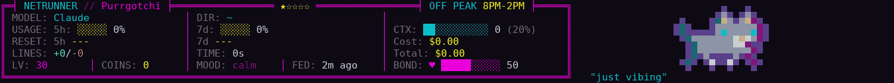

# Purrgotchi

A cyberpunk Claude Code statusline with a persistent tamagotchi kitten.



Renders a 7-row HUD showing model, DIR, GIT, rate-limit bars + reset times, per-turn cost / session total, LINES / TIME, and a stat row — alongside a live, 1 fps pixel-art cat (24-bit half-block graphics) whose mood reflects context pressure. The kitten persists across all Claude Code sessions on a machine, earns coins per tool call, levels up, evolves through life stages, builds bond through interaction, celebrates milestones, and (optionally) speaks LLM-generated mood-contextual dialogue that reacts to what you just did.

---

## Requirements

- **Rust toolchain** (any recent stable; tested on 1.78+) — `rustup install stable`.
- **Claude Code** ([anthropic.com/claude-code](https://www.anthropic.com/claude-code)).
  - Runs as the statusline + hooks on any recent Claude Code (playground scenes need ≥ 2.1.153).
- **`jq`** and **Bash** (for `install.sh`) — `winget install jqlang.jq` on Windows, `brew install jq` on macOS, your package manager on Linux. On Windows, use Git Bash, MSYS2, or WSL.
- **(Optional) An LLM provider API key** — Anthropic, Gemini, or OpenAI — to enable AI-generated personality blurbs and in-character react quips. Without one, Purrgotchi falls back to a curated static phrase pool with no errors.

Built and validated on Windows 11 (`x86_64-pc-windows-msvc`). Linux and macOS builds compile cleanly via `cargo build --release` but are not yet exercised in production.

---

## Install

The statusline + feed/turn hooks:

```bash
git clone https://github.com/Englader/purrgotchi.git
cd purrgotchi
cd rust && cargo build --release && cd ..
bash install.sh
```

`install.sh` is idempotent — safe to re-run after upgrades. It:

1. Verifies prerequisites (`jq`, the compiled binary).
2. Backs up `~/.claude/settings.json` with a timestamped suffix.
3. Creates the state directory at `~/.claude/purrgotchi/`.
4. Merges the statusline + `PostToolUse` (feed) + `UserPromptSubmit` (turn) hooks into `settings.json`, all pointing at `rust/target/release/purrgotchi.exe`.

**Restart Claude Code after install** so the new settings take effect. To drop the feed/turn hooks again later while keeping the statusline, run `bash install.sh --uninstall-hooks`.

### Manual wiring (reference)

If you'd rather edit `~/.claude/settings.json` by hand:

```json
{
  "statusLine": {
    "type": "command",
    "command": "C:/absolute/path/to/purrgotchi/rust/target/release/purrgotchi.exe statusline",
    "padding": 1,
    "refreshInterval": 1
  },
  "hooks": {
    "PostToolUse": [{
      "matcher": "*",
      "hooks": [{ "type": "command", "command": "C:/absolute/path/to/purrgotchi/rust/target/release/purrgotchi.exe feed" }]
    }],
    "UserPromptSubmit": [{
      "hooks": [{ "type": "command", "command": "C:/absolute/path/to/purrgotchi/rust/target/release/purrgotchi.exe turn" }]
    }]
  }
}
```

Note that `refreshInterval` sits **inside** the `statusLine` object — Claude Code ignores it anywhere else. It re-runs the statusline every second even while the session idles, which is what makes the kitten actually animate.

### Optional: the `purr` wrapper

Commands are plain shell commands. A tiny wrapper on your `PATH` turns them into `purr <verb>`, and inside Claude Code you run them with the `!` shell prefix (e.g. `! purr pet`):

```bash
mkdir -p ~/.local/bin && cat > ~/.local/bin/purr <<'EOF'
#!/usr/bin/env bash
exec "${PURRGOTCHI_BIN:-$(command -v purrgotchi || echo "$HOME/path/to/purrgotchi/rust/target/release/purrgotchi")}" "$@"
EOF
chmod +x ~/.local/bin/purr
```

Set `PURRGOTCHI_BIN` to point it at a specific binary, or edit the fallback path. Then `! purr pet`, `! purr play`, `! purr treat`, `! purr card`, `! purr stats` and `! purr rename <name>` work from any session.

---

## Optional: enable AI personality and react quips

Without an API key, Purrgotchi works fine with a curated static phrase pool. To unlock:

- A unique LLM-generated personality blurb at hatch (matched to your kitten's breed, rarity, and stat profile).
- A 1-in-5 chance per turn that your kitten reacts in-character to whatever you just did in Claude Code (~1s latency, ~10 output tokens).

Copy the example env file and uncomment **one** provider block:

```bash
cp .env.example .env
```

```bash
# .env — uncomment one block:

# --- Anthropic ---
# PURR_LLM_PROVIDER=anthropic
# ANTHROPIC_API_KEY=sk-ant-api03-...
# PURR_LLM_MODEL=claude-haiku-4-5

# --- Gemini ---
# PURR_LLM_PROVIDER=gemini
# GEMINI_API_KEY=...
# PURR_LLM_MODEL=gemini-2.5-flash

# --- OpenAI ---
# PURR_LLM_PROVIDER=openai
# OPENAI_API_KEY=sk-...
# PURR_LLM_MODEL=gpt-4o-mini
```

Purrgotchi reads `.env` from **`~/.claude/purrgotchi/.env`** only (`install.sh` copies the repo's `.env` there on first install). It deliberately does not load `.env` from the current directory — hooks run with the cwd of whatever project you have open, and a stranger repo's `.env` should never be able to inject keys or config. Process-level environment variables (e.g. shell-exported) win over `.env` values. `PURR_LLM_PROVIDER` is **required**; `PURR_LLM_MODEL` is optional and defaults to the cheapest fast model for each provider. Daily LLM cost runs roughly **$0.01–$0.06** at typical Claude Code usage rates.

After hatching with no provider configured, you'll see a one-line stderr hint reminding you these env vars exist. Configure later via `purrgotchi rename`-style on-disk edits — no restart of the kitten needed.

---

## Your pixel cat

Since v4.0.0 the cat to the right of the HUD box is drawn as pixel art, 6 rows tall (12 pixels via `▀` half-blocks with 24-bit colour), with a speech line below. Claude Code re-runs the statusline every second when `statusLine.refreshInterval` is `1` (the installer sets it), so she moves at 1 fps.

- **Idle life** — she wanders, runs, grooms, stretches, loafs, curls up asleep with a Z, and more, in 30-second blocks. What she does depends on her mood: a sleeping cat stays curled up, a hungry one looks about and meows, and a panicking one (context nearly full) runs back and forth. The same poses are painted in each breed's own colours with a rarity rim.
- **Moods** — calm, happy, alert, hungry, panic and sleep, driven by context-window pressure, how recently she was fed, and how recently you petted or played with her.
- **Scenes** — every few minutes she plays in the open space to the right: ball, butterfly, zoomies, rolling, yarn. The pixel cat pounces, misses, and catches or loses her toy mid-scene. `! purr play` starts one right away. See [Playground scenes](#playground-scenes).
- **Celebrations** — level-ups, evolutions, tool-call streaks, milestones (100 / 500 / 1000 calls), the daily greeting, random coin drops and birthdays each get their own pixel overlay.
- **Fallbacks** — it needs a terminal with 24-bit colour and about 125+ columns. On a narrower terminal, with `PURR_PIXELS=0`, or with `NO_COLOR` set, you get the classic ASCII cat instead. The HUD box itself is identical in every mode.

To check that your terminal renders background colours, run `purrgotchi pixels test` (or set `PURR_PIXELS=test` for the statusline).

---

## The cat band (v4.1)

v4.1 adds an optional Claude Code **mod** (`mod/`) that draws the pixel cat in a band above the prompt, 5 rows tall, at 30 fps. It is terminal only: it needs a Claude Code build with the mods API and a 24-bit colour terminal. Without the mod, nothing changes from v4.0.

Try it from a built checkout (`<WT>` is the checkout path; build first with `cd <WT>/rust && cargo build --release`):

```bash
# Band only: the statusline cat still shows too
PURR_BIN=<WT>/rust/target/release/purrgotchi claude --plugin-dir <WT>/mod

# Band plus statusline override: the statusline drops its cat and boxes her speech
PURR_BIN=<WT>/rust/target/release/purrgotchi PURR_BAND_ROWS=5 claude --plugin-dir <WT>/mod \
  --settings '{"statusLine":{"type":"command","command":"<WT>/rust/target/release/purrgotchi statusline","padding":1,"refreshInterval":1}}'

# A taller cat (6 rows, 12 px art) and a faster one
PURR_BIN=<WT>/rust/target/release/purrgotchi PURR_BAND_ROWS=6 claude --plugin-dir <WT>/mod
PURR_BIN=<WT>/rust/target/release/purrgotchi PURR_BAND_FPS=60 claude --plugin-dir <WT>/mod
```

Settings (environment variables, read when a session starts):

- `PURR_BAND_ROWS`: `5` (default, 10 px art) or `6` (12 px art). Anything else means 5. On a terminal too short for the requested height the band uses the largest that fits, and hides if even 5 rows do not fit.
- `PURR_BAND_FPS`: frames per second, default `30`, range 15 to 60 (values outside it are clamped; a non-number means 30).
- `PURR_BIN`: the purrgotchi binary to use.

Binary lookup order: `PURR_BIN` (if the file exists), then `purrgotchi` on `PATH`, then `~/.claude/purrgotchi/bin/purrgotchi`. If none is found, or the binary is v4.0 and has no `band` verb, the band draws nothing and the statusline keeps her cat.

**Statusline handoff.** While the band is running, the mod writes a heartbeat file (`band-<session id>.alive` in the state directory) about once a second. While that beat is fresh (under 3 s), the statusline drops its own cat and shows her speech in a box on the right of the HUD, joined to the HUD border. If the band stops (crash, collapse, a terminal too short), the cat returns to the statusline within 3 s. The HUD box itself is unchanged.

**Speech box width.** The box is `min(50, COLUMNS - 98)` columns wide and needs at least 20, so about 118 columns. When `COLUMNS` is unknown or too small, the statusline never wraps: it shows the speech as a loose line instead of the box.

**Limitations.**

- Terminal only; it relies on the terminal UI.
- If the mod cannot learn the session id, it writes a global `band.alive` instead. Only a statusline whose own payload has no valid session id honours it, so a session with an id never reacts to another session's band.
- The band reads purrgotchi state read-only. The `settings.json` hooks (`feed`, `turn`) still feed the kitten, so keep them installed.

## Neon Grid (v4.2, backdrop v4.3)

v4.2 adds a cyberpunk restyle of Claude Code's terminal UI, shipped in the same mod (`mod/`). It is a custom theme plus six restyled pieces. Terminal only; it needs the mod loaded (for example `alias claude='claude --plugin-dir <WT>/mod'`) and 24-bit colour.

**Pick the theme once.** Run `/theme` and choose "Neon Grid". It is stored as `custom:purrgotchi:neon-grid`. The mod never sets it, so without picking it your current theme stays.

**Terminal background (v4.3).** A theme cannot paint the terminal background, so while Neon Grid is the active theme the mod sets it to `#0d0a14` itself (OSC 11). Switching to another theme or quitting puts your terminal's own background back (OSC 111); `/clear` keeps it. This is a workaround, not an official API: the mod writes the sequence to Claude Code's tty via `ps`. Ctrl+Z (suspend) and a hard crash leave the background dark, tmux is untested and may not pass it through, terminals without OSC 11 ignore it, and headless (`-p`) runs do nothing.

**What is restyled** (one example per piece):

- Spinner word: `▓▒░ DECRYPTING ░▒▓`. The word rotates per turn; the engine keeps its own `(12s · tokens)` tail.
- Turn duration: `◢◤ EXECUTED IN 12.3s ◢◤`
- Info notices: `▸ ` before the notice text, uppercased. Paths, filenames and `/commands` keep their own case.
- Session mode: `⟦ FOCUS ⟧` (label text uppercased).
- Hint line: `[?] SHORTCUTS`. Only hints the engine shows and the mod knows are redrawn.
- Background pill: `[CTRL+B] SEND TO BACKGROUND`

**Engine-drawn, only recoloured by the theme:** the logo, the input box, the permission dialog, the menus, and the left `⏵⏵ auto mode on` indicator.

**Passes through untouched:** hints the mod does not recognise (the engine draws them as before), the engine's own spinner messages, and the desktop app.

The HUD statusline and the band cat are unchanged.

**Regenerating the theme.** `mod/themes/neon-grid.json` is generated from `mod/hooks/neon.ts`:

```bash
node mod/scripts/theme.mjs          # rewrite the theme file
node mod/scripts/theme.mjs --check  # fail if the file is out of date
```

**Windows.** Windows Terminal is recommended. Use a font that has the glyphs `▓▒░ ◢◤ ⟦⟧ ▸`.

---

## Your kitten

On first run, Purrgotchi automatically hatches a kitten deterministically from your machine identity (`username:hostname:birth_time` seed). Kittens are permanent — the same machine always produces the same kitten.

```bash
purrgotchi card     # full identity card — breed, rarity stars, stats, personality, bond
purrgotchi stats    # human-readable view of identity, mechanics, progress, lifetime cost
```

### Rarity tiers

| Rarity | Stars | Distribution |
|---|---|---|
| Common | ★☆☆☆☆ | 60% |
| Uncommon | ★★☆☆☆ | 25% |
| Rare | ★★★☆☆ | 10% |
| Epic | ★★★★☆ | 4% |
| Legendary | ★★★★★ | 1% |
| Shiny | ✦ prefix | +1% on top of any tier |

Sprite color follows rarity: cyan → green → purple → gold → cycling rainbow (legendary) → animated shimmer (shiny).

### Life stages

Kittens evolve as they level up: **kitten → young cat → adult**. Each stage has its own sprite set and its own celebration animation when crossing the threshold.

### Stats

Five feline traits — **Curiosity, Mischief, Laziness, Affection, Wisdom** — generated with peak/dump distribution. Higher rarity raises the floor on the middle three.

### Bond

A 0–100 dynamic counter starting at 50. Grows when you interact (pet, play, treat); decays slowly when neglected (5/day, anchored to the most recent interaction). Visible as a bar on the card and the HUD.

---

## Subcommands

| Command | Purpose |
|---|---|
| `purrgotchi statusline` | Renders the HUD (reads Claude Code's payload on stdin) |
| `purrgotchi feed` | `PostToolUse` hook — bumps tool-call count, coins, level; updates `last_fed_at` |
| `purrgotchi turn` | `UserPromptSubmit` hook — clears per-turn cost anchor; rolls 1-in-5 dice for `react` |
| `purrgotchi react <transcript>` | Detached LLM worker (spawned by `turn`) — generates an in-character quip |
| `purrgotchi card` | Full identity card with stats, personality, bond |
| `purrgotchi stats` | Human-readable view of identity, mechanics, lifetime cost |
| `purrgotchi pet` | +15 bond, 4h cooldown, 120s happy mood window |
| `purrgotchi play` | 50 coins, +20 bond, 6h cooldown, 180s happy mood window |
| `purrgotchi treat` | 25 coins, +5 bond, 4h cooldown, 120s happy; resets hunger |
| `purrgotchi hatch [--rarity R]` | Hatches the kitten explicitly (normally automatic on first run) |
| `purrgotchi rename <name>` | Renames the kitten in `state.json` (personality re-templates at render time) |
| `purrgotchi frame [--json] [--width N] [--advance]` | JSON snapshot of the kitten (scripting/debug; reads state without writing it unless `--advance`, which also runs the timers) |
| `purrgotchi pixels test\|sheet\|scene\|celebrate` | Pixel cat tools: `test` prints the background-colour test card; `sheet`, `scene` and `celebrate` preview art (add `--json` for a machine-readable dump) |
| `purrgotchi --version` | Prints the crate version |

Every action command (`feed`, `turn`, `pet`, `play`, `treat`, `rename`, `stats`, `card`) also takes `--json` for a versioned machine-readable result (for scripts), and `feed --count N` batches N tool calls into one call. Set `PURR_STATE_DIR` to an absolute path to run against a throwaway state directory instead of `~/.claude/purrgotchi/`.

### Events and celebrations

- **Tool-call streaks** — a "5 in a row!" one-shot speech overlay.
- **Milestones** — 100 / 500 / 1000 lifetime tool calls each get a unique celebration.
- **Birthday** — on the anniversary of your kitten's hatch, a special sprite + speech for the day.
- **Daily greeting** — first prompt of each day triggers a "welcome back".
- **Random drops** — low-probability "+10 coins" surprises.

Priority order for HUD overlays: **celebration > birthday > scene > LLM quip > mood**.

---

## Playground scenes

Thalia doesn't just sit beside her card — every few minutes she plays in the
open space to the right of it: chasing a bouncing ball, stalking a butterfly,
doing zoomies, rolling across the screen, or pushing a ball of yarn. Scenes
last 20–40 seconds, pick themselves at random (never the same one twice in a
row), and `purr play` starts one immediately.

- Needs a reasonably wide terminal (~125+ columns) and Claude Code v2.1.153 or
  newer (which reports the terminal width to the status line). On narrower
  terminals the playground simply stays off — nothing breaks.
- To turn scenes off entirely, add `PURR_PLAYGROUND=0` to
  `~/.claude/purrgotchi/.env`.
- Scenes are drawn in pixel art by default and fall back to ASCII along with the rest of the cat.

---

## Source vs state

- **Source** (this repo): Rust crate in `rust/`, sprites in `sprites/` (embedded via `include_str!`), specs/plans in `docs/superpowers/` — versioned in git.
- **State** (`~/.claude/purrgotchi/`): `state.json` (level, coins, bond, feed time, ...), `cost-sessions.json` (per-session cost sidecar with 30-day GC), `llm-quip.json` (transient quip cache, 6-render TTL), `turn-start-cost.txt` — per-machine, **never** versioned.

---

## Customize

- **Rename the kitten:** `purrgotchi rename "NewName"`.
- **Add ASCII sprites:** drop new `<mood>_<frame>.txt` files into `sprites/`, add branches in `rust/src/sprites.rs`, rebuild. The pixel art lives in `rust/src/px/`.
- **Add static phrases:** edit the per-mood arrays in `rust/src/speech.rs`, rebuild.
- **Tweak colors:** edit the constants at the top of `rust/src/colors.rs`.
- **Pixel cat mode:** `PURR_PIXELS=0` restores the classic ASCII cat; `PURR_PIXELS=fg` uses foreground colours only (no background colour, for terminals that mangle it); `PURR_PIXELS=1` forces full pixel mode; `PURR_PIXELS=test` shows a colour test card. A non-empty `NO_COLOR` always forces the ASCII cat. Put these in `~/.claude/purrgotchi/.env` or export them in your shell.
- **Playground:** `PURR_PLAYGROUND=0` disables scenes; `PURR_PLAYGROUND_WIDTH=<columns>` sets the width of the cat/playground column itself (clamped to 24..120, nothing subtracted for the HUD box), for hosts that do not report `COLUMNS`. It also lets the pixel cat draw when `COLUMNS` is missing; without either, you get the ASCII cat.
- **Debug logging:** set `PURR_DEBUG=1` (or pass `--debug`) to write timestamped lines to `~/.claude/purrgotchi/debug.log` — covers LLM call latency, token counts, react worker outcomes, watchdog events, and statusline render timing. Enable system-wide by appending `--debug` to the `statusLine.command` in `~/.claude/settings.json` and restarting Claude Code.

---

## Cost display

- **Cost** — spend since your last prompt submit (anchor cleared by the `turn` hook).
- **Total** — session cumulative from `.cost.total_cost_usd`.
- **Lifetime** — accumulated across every session ever (visible in `purrgotchi stats`).

A 500ms anchor grace window (microsecond-precision via `SystemTime::now()`) absorbs Claude Code's async token-finalization of the prior turn so trailing cents don't leak into the new turn.

Cost tracking currently captures Anthropic-only API spend; Gemini and OpenAI calls don't update the lifetime accumulator.

---

## Architecture & docs

- **Per-release CHANGELOG:** [`CHANGELOG.md`](./CHANGELOG.md).
- **Design specs:** `docs/superpowers/specs/` — one per major feature or hotfix, written before implementation.
- **Implementation plans:** `docs/superpowers/plans/` — bite-sized TDD task lists derived from each spec.
- **Master plan:** `docs/superpowers/plans/kitten-mechanics-master-plan.md` — phase roadmap and progress log.

All four phases of the master plan have shipped (Phase 1 identity → Phase 2 character depth → Phase 3 LLM speech → Phase 4 provider-agnostic LLM). Current release: **v4.1.0** (the optional cat band above the prompt, on top of v4.0's pixel-art cat; `PURR_PIXELS=0` keeps the classic ASCII cat — see the [CHANGELOG](./CHANGELOG.md) for notes).
