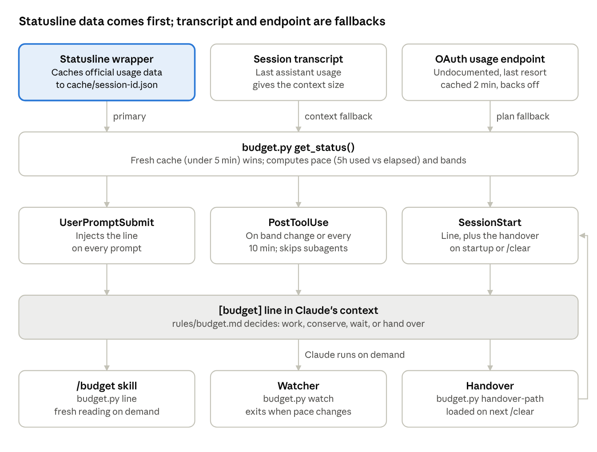

# Budget Pacing System for Claude Code — Setup Guide

Oct 18, 2026 · Stefan

## Purpose

The budget system lets Claude see your plan usage on every turn, so it can pace itself through the whole 5-hour window instead of hitting the limit halfway.

On its own, Claude Code gives the model no view of three limits:

- **5-hour window:** the rolling plan limit. If you burn it in 2 hours, you wait 3.
- **7-day limit:** the weekly cap. Hitting it costs days, not hours.
- **Context size:** quality drops and cost per turn rises as the conversation grows. We set a 400k soft cap and hand over to a fresh session before reaching it.

The system has two halves. Both are needed:

1. **Mechanics** (hooks + a Python script): measure usage and inject one `[budget]` line into Claude's context.
2. **Behavior** (rules files): tell Claude what to do with that line. Without the rules, the line is just noise.

## What it gives Claude

Claude gets one line injected into its context, plus four tools it can call to act on that line.

**The injected line** looks like this:

```
[budget] 5h: 51% used / 68% elapsed (ON-PACE) · resets 14:40 (1h37m) · 7d: 42% · ctx: 55k/400k soft cap
```

| Field | Meaning |
| --- | --- |
| 5h used / elapsed | Share of the 5h limit spent vs share of the window that has passed |
| Pace | ON-PACE (used ≤ elapsed + 5), AHEAD (spending faster than time), WALL (used ≥ 90%) |
| resets | Local clock time the 5h window resets, and time left |
| 7d | Weekly usage. `7D CRITICAL` is added at ≥ 85% |
| ctx | Current context tokens vs the 400k soft cap. `CTX HANDOVER ZONE` at ≥ 300k, `CTX OVER CAP` at ≥ 400k |

**What Claude does with it** (from `rules/budget.md`):

| State | Behavior |
| --- | --- |
| ON-PACE | Work normally |
| AHEAD | Conserve: delegate to Sonnet/Haiku, short turns, no fan-outs, workflows or big reviews |
| WALL, reset < 60 min | Finish the step, commit, sleep until reset |
| WALL, reset ≥ 60 min | Write a handover and tell you |
| WALL while you're AFK | Always wait, then continue |
| 7D CRITICAL | Tell you; critical work only |
| CTX HANDOVER ZONE | No new large pieces; finish, test, commit, write handover |
| CTX OVER CAP | Stop and hand over now |

**The tools:**

- **`/budget` skill:** a fresh reading on demand, before expensive work.
- **`budget.py watch`:** a background watcher while subagents run. The main session sees no hook output while idle, so the watcher exits on a pace change, the wall, 7d critical, a reset, or a 50-min heartbeat.
- **`budget.py handover-path`:** where to write the handover doc. The next `/clear` or new session in that repo loads it automatically, then archives it.
- **Waiting:** a background `sleep` in ~50-min chunks. The prompt cache lasts 1h, so a wake every ~50 min keeps it warm without wasting budget.

## How it works

One Python script, `budget.py`, does everything. The statusline feeds it data, three hooks inject its output, and Claude calls it directly for on-demand checks.



The statusline runs on every refresh and writes the official numbers to a cache. Each hook reads that cache, and falls back to the transcript or the endpoint only when the cache is over 5 minutes old. The handover arrow loops back: a handover written in one session is loaded by the next session's SessionStart.

Pace compares usage with how much of the 5h window has passed:

```
elapsed% = (now − (reset − 5h)) / 5h × 100
```

The result is ON-PACE if used ≤ elapsed + 5, AHEAD if more, and WALL at used ≥ 90 regardless.

| Subcommand | Called by | Does |
| --- | --- | --- |
| `cache` | Statusline wrapper | Saves `rate_limits` + `context_window` to `cache/<session>.json` |
| `hook-prompt` | UserPromptSubmit | Injects the line every prompt; saves bands to `state/` |
| `hook-posttool` | PostToolUse | Injects the line only on a band change or after 10 min |
| `hook-sessionstart` | SessionStart | Injects the line, plus the handover file on `startup`/`clear`, then archives it |
| `line` | `/budget` skill | Prints the line |
| `watch` | Claude, as background Bash | Polls every 3 min; exits on pace worse, wall, 7d ≥ 85, reset, or 50-min heartbeat |
| `handover-path` | Claude | Prints `~/.claude/handovers/<repo-slug>.md` |

## How we built it

We built it in about a day, starting from one request: work the full 5 hours "without filling up the session limit", so you never have to say "we're at 80%, stop".

| When (local) | Step | Detail |
| --- | --- | --- |
| Oct 18, 11:00 | Wall-wait timing | Last wake 5–10 min before the reset |
| Oct 18, 00:49 | Wall-wait rule | Ping every ~50 min to keep the cache warm, then wake just before the reset, so the cache refill is billed to the old window |
| Oct 18, 00:05 | Watcher | You asked whether Claude sees the budget while subagents run. It doesn't: hooks fire only on its own tool calls. A Sonnet agent added `budget.py watch` (tests: 10 → 20) |
| Oct 18, 00:02 | Handover bug fix | Handovers were named after the shell's cwd, so a session that ended in a subfolder lost its handover. `project_root()` now resolves subfolders and worktrees to the main repo root |
| Oct 17, 15:15 | Handover test | A dummy handover was loaded and archived on `/clear` and confirmed in a second terminal |
| Oct 17, 15:12 | First build | A Sonnet subagent wrote `budget.py`, the wrapper, 9 tests and the `/budget` skill. Hooks went into settings.json, with a backup at `settings.json.bak-budget` |
| Oct 17, 15:07 | Design | Statusline cache first, endpoint fallback, throttled PostToolUse line, handover on SessionStart, rules in `rules/budget.md` |
| Oct 17, 14:55 | The ask | "A skill to check your context limit just like I can see with /usage." The focus shifted to the 5h limit |

**Key decisions and why:**

- **Hooks, not just a skill.** A skill runs only when something prompts Claude to call it. A hook keeps the number in front of Claude on every turn. The `/budget` skill stays for on-demand checks.
- **Official data first.** The statusline input carries `rate_limits` and `context_window`. The OAuth usage endpoint (`api.anthropic.com/api/oauth/usage`) is undocumented and could change, so it's only a fallback. If both fail, the line says "usage unavailable" rather than show a wrong number.
- **Pace = used% vs elapsed%.** A raw percentage doesn't say whether you're spending too fast. 50% used with 80% of the window gone is fine. 50% used with 20% gone is not.
- **Downshift means delegating.** Your first idea was "only small agents near the limit". The main Opus thread is the biggest cost, so the rule is the reverse: delegate more to Sonnet and Haiku. You added that a task failed twice by Sonnet or Haiku goes to Opus.
- **Throttled PostToolUse.** A line after every tool call would flood the context. It's emitted only when a band changes (5h at 50/70/80/90/95%, ctx at 200k/300k/350k/400k, 7d at 70/85/95%, or a pace change), or every 10 minutes. Subagent tool calls are skipped.
- **Handover before compaction.** Auto-compaction on the 1M window fires near 967k, far past where quality drops. The 300k and 400k caps make a clean handover happen first. Claude can't run `/clear` itself, so you type `/clear`, then `go`.
- **The watcher reacts to changes, not levels.** A watcher started at the wall stays quiet until the reset instead of firing on every check.

## Windows port status (Oct 18, 2026)

Ported and verified on Windows 11. The section below is the original plan; what actually shipped differs:

- **budget.py patches are already in the bundled file** (shared by both OSes): regex `slug_of()`, UTF-8 stdin/stdout, `write_json_atomic` retries the Windows `PermissionError` and never leaves a tmp file, lazy `urllib` import, and `handover-path` prints forward slashes.
- **No Python statusline wrapper.** Every process launch costs ~200 ms on this machine, so a wrapper took the statusline from 186 ms to 514 ms. Instead, `purrgotchi.exe statusline` will write the budget cache itself (v4.3 port). Until then, plan numbers come from the OAuth fallback and ctx from the transcript; both work.
- **Tests:** 24 total. Windows: 22 pass, 2 skipped (bash wrapper, Linux-only). Linux: run `python3 test_budget.py`; expect 24 passing.
- **On Linux after pulling:** copy `hooks/budget/budget.py` and `test_budget.py` to `~/.claude/hooks/budget/` and run the tests. Note that slugs now replace every non-alphanumeric character, so a pending handover for a path containing `_` or spaces gets a new filename.

## Recreating on Windows

Copy six files, make three small edits to `budget.py`, replace the bash statusline wrapper with a Python one, then add four entries to `settings.json`.

**Prerequisites:** Claude Code for Windows (it uses Git Bash for its Bash tool), and Python 3 from python.org with "Add to PATH" ticked. Check with `python --version`. If `python` opens the Microsoft Store, turn off the alias under Settings → Apps → Advanced app settings → App execution aliases, or use `py -3` everywhere below.

### 1. Copy the files

`~` is `%USERPROFILE%` (for example `C:\Users\you`).

| File | Windows location | Role |
| --- | --- | --- |
| `budget.py` | `~\.claude\hooks\budget\` | Core script, all subcommands |
| `test_budget.py` | `~\.claude\hooks\budget\` | 20 unit tests |
| `README.md` | `~\.claude\hooks\budget\` | Short reference |
| `SKILL.md` | `~\.claude\skills\budget\` | The `/budget` skill |
| `budget.md` | `~\.claude\rules\` | Behavior rules: pace states, wall, waiting, handover |
| `preferences.md` (the "Work budget-aware" bullet) | `~\.claude\rules\` | Read the line every turn, downshift when AHEAD |

Don't copy `statusline-wrap.sh`, `cache\` or `state\`. The two folders are created on first run.

### 2. Patch budget.py (3 edits)

1. **Project slug.** `slug_of()` only replaces `/` and `.`, so a Windows path like `C:\Users\you\proj` keeps `:` and `\`. That makes the handover filename invalid. Replace the function with the rule Claude Code uses for its own `projects` folders (any non-alphanumeric character becomes `-`):

    ```python
    import re

    def slug_of(cwd):
        return re.sub(r"[^A-Za-z0-9]", "-", cwd)
    ```

    To confirm, compare the folder names in `~\.claude\projects\` with your repo paths.

2. **UTF-8 on stdin/stdout.** Windows Python defaults to cp1252. Hook input that contains non-ASCII paths would fail to parse, and the `·` separator could come out garbled. Add these as the first lines of `main()`:

    ```python
    sys.stdin.reconfigure(encoding="utf-8", errors="replace")
    sys.stdout.reconfigure(encoding="utf-8")
    ```

3. **Credentials check (no edit if present).** The fallback reads `~\.claude\.credentials.json`. If that file doesn't exist on your machine, the fallback quietly turns off. That's fine as long as the statusline (step 3) runs, because the statusline is the main data source.

### 3. Replace the statusline wrapper

The Linux wrapper is a bash script that forks the cache write into the background. On Windows, use Python instead. The cache write takes milliseconds, so it can run inline. Save as `~\.claude\hooks\budget\statusline-wrap.py`:

```python
"""Statusline: caches budget data, then shows a status line."""
import json, os, subprocess, sys

sys.path.insert(0, os.path.dirname(os.path.abspath(__file__)))
import budget

sys.stdout.reconfigure(encoding="utf-8")
raw = sys.stdin.buffer.read().decode("utf-8", "replace")
try:
    budget.cmd_cache(raw)
except Exception:
    pass

cmd = os.environ.get("BUDGET_WRAPPED_CMD")
if cmd:  # pass through to another statusline, e.g. purrgotchi
    sys.exit(subprocess.run(cmd, shell=True, input=raw.encode("utf-8")).returncode)

try:  # no other statusline: show the budget line itself
    d = json.loads(raw)
    st = budget.get_status(d.get("session_id"), d.get("transcript_path"))
    print(budget.fmt_line(st).replace("[budget] ", ""))
except Exception:
    print("budget: unavailable")
```

### 4. Add to settings.json

Edit `~\.claude\settings.json`. Use forward slashes in paths, and merge into any `hooks` arrays you already have. Don't replace them:

```json
{
  "statusLine": {
    "type": "command",
    "command": "python C:/Users/you/.claude/hooks/budget/statusline-wrap.py",
    "padding": 1
  },
  "hooks": {
    "UserPromptSubmit": [{"hooks": [{"type": "command", "command": "python C:/Users/you/.claude/hooks/budget/budget.py hook-prompt", "timeout": 5}]}],
    "PostToolUse": [{"matcher": "*", "hooks": [{"type": "command", "command": "python C:/Users/you/.claude/hooks/budget/budget.py hook-posttool", "timeout": 5}]}],
    "SessionStart": [{"hooks": [{"type": "command", "command": "python C:/Users/you/.claude/hooks/budget/budget.py hook-sessionstart", "timeout": 5}]}]
  }
}
```

To pass through to another statusline, also set `"env": {"BUDGET_WRAPPED_CMD": "<that command>"}`.

### 5. Update the commands in the skill and rules

In `SKILL.md` and `rules/budget.md`, change `python3` to `python`. You can keep the `~/.claude/...` paths, because Claude's Bash tool runs in Git Bash, which expands `~`. Background `sleep` and `budget.py watch` work there unchanged.

**Known benign:** if a hook reads a cache file while the statusline is rewriting it, `os.replace` can raise `PermissionError` on Windows. `main()` catches every error, so at worst one reading is stale.

## Verification and troubleshooting

It works when the status bar shows the budget line, and Claude can quote a `[budget]` line from its context after your first prompt.

Run these in order:

1. **Unit tests:** `python ~/.claude/hooks/budget/test_budget.py`. All 20 pass on Linux; none of this guide has been tested on Windows yet. The 2 tests that run `statusline-wrap.sh` directly can't pass there: delete them, or point `WRAP` at the `.py` wrapper and run it with `sys.executable`.
2. **Manual line:** in Claude's Bash tool, `python ~/.claude/hooks/budget/budget.py line` prints one `[budget]` line. The Bash tool sets `CLAUDE_CODE_SESSION_ID`.
3. **Statusline cache:** restart Claude Code and send one prompt. `~\.claude\hooks\budget\cache\<session-id>.json` should appear, with `rate_limits` and `context_window` filled in.
4. **Injection:** ask Claude "what does your budget line say?" It should quote the numbers.
5. **Handover:** in a repo, run `python ~/.claude/hooks/budget/budget.py handover-path`, write a test note to that path, then `/clear`. Claude should see "HANDOVER from previous session", and the file should move to `~\.claude\handovers\archive\`.

| Symptom | Likely cause | Fix |
| --- | --- | --- |
| `python` opens the Microsoft Store | App execution alias | Turn the alias off, or use `py -3` |
| `plan usage unavailable` | Statusline not running, and no `.credentials.json` for the fallback | Test it: `echo {} \| python <path>/statusline-wrap.py`. Check the `statusLine` path in settings.json |
| `ctx: ?` | No `context_window` in statusline input, and the transcript wasn't found | Check that `~\.claude\projects\<slug>\<session>.jsonl` exists |
| No `[budget]` line at all | A hook fails silently (`main()` swallows every error) | Run it by hand: `echo {"session_id":"x"} \| python <path>/budget.py hook-prompt` |
| Garbled `·` | UTF-8 reconfigure missing | Patch 2 in step 2 |
| Handover not loaded | Slug patch missing, or the session wasn't a `startup`/`clear` (resume doesn't load it) | Patch 1, then compare `handover-path` output with the file you wrote |
